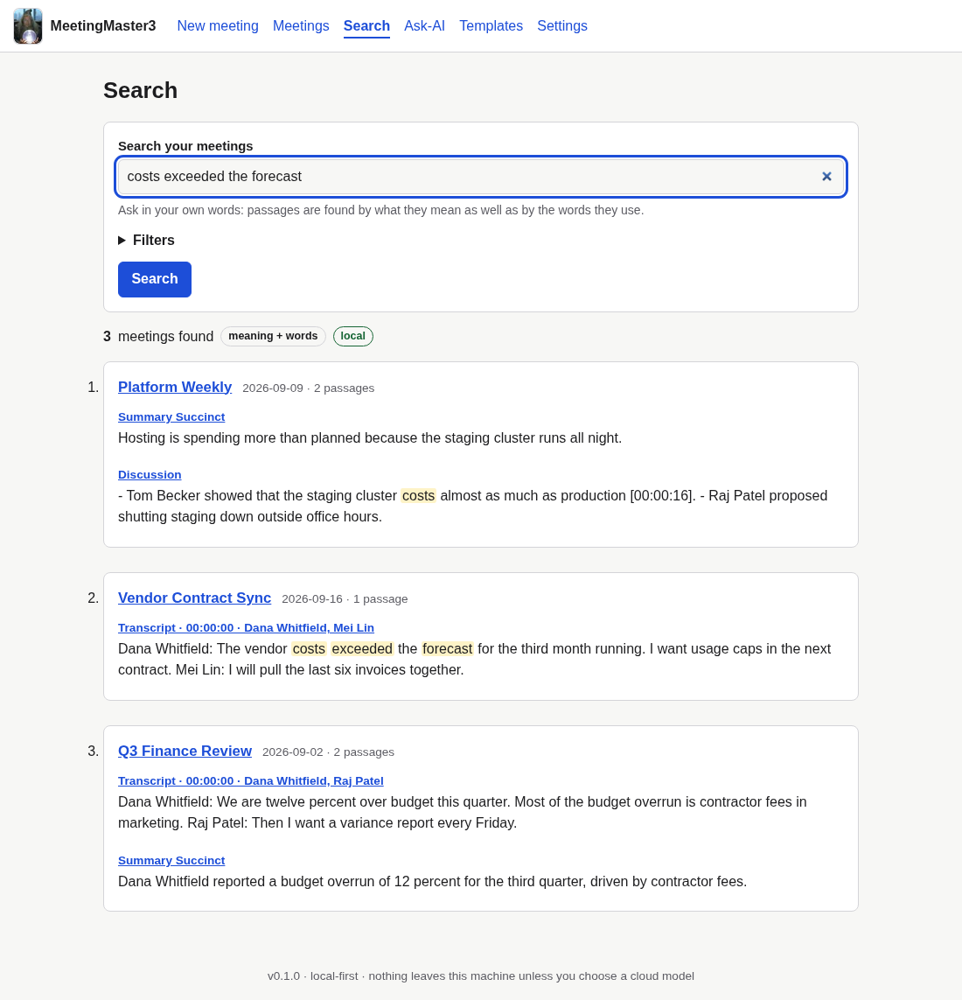
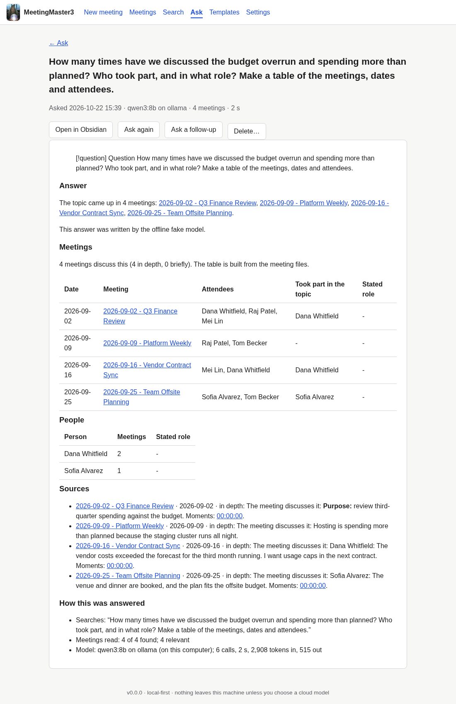

# MeetingMaster3


**Turn meeting audio into speaker-attributed transcripts and secretary-grade, Obsidian-native Markdown notes, entirely on your own machine.**

[](https://github.com/antonizick/MeetingMaster3/actions/workflows/ci.yml)
[](LICENSE)
[](CHANGELOG.md)

Drop in a recording. MeetingMaster3 transcribes it (WhisperX), works out who said what, lets you name the
speakers once, and writes a structured note into your Obsidian vault with a language model that runs
locally (Ollama) unless you choose a cloud one. Then you can review the note beside the audio, regenerate any
section, search every meeting by meaning, and ask questions across all of them. It is free, open source
(Apache-2.0), runs on `localhost` for a single user, and has no telemetry.

## Contents
[Features](#features) · [Privacy](#privacy-stance) · [Quickstart (Docker)](#quickstart-docker) ·
[Native install](#native-install) · [Using it](#using-it) · [Configuration](#configuration) ·
[Hardware](#hardware-guidance) · [Known limitations](#known-limitations) · [FAQ](#faq-and-troubleshooting) ·
[Project status](#project-status) · [Contributing](#contributing-and-security) · [License](#license)

## Features
- **Audio to note.** Upload audio, get a diarized transcript (WhisperX: faster-whisper, wav2vec2 alignment,
  pyannote), name the speakers, and receive a note in your vault with frontmatter, wikilinks, a full-fidelity
  companion transcript and a readable, colour-coded one. Jobs are queued, checkpointed and resumable, with live
  progress and an ETA.
- **Speakers.** Name each speaker once, with sample clips to listen to. Optional local voiceprints (off by
  default) suggest names in later meetings.
- **24 templates** (Default Notes by topic, Executive Summary, Decision Log, Action-Focused, Job Interview
  Notes, Board Minutes, Stand-up, Retrospective, Create Project Plan and more), each opening with a short and a
  detailed summary. They are plain files in your vault: edit, duplicate or write your own
  ([catalogue](docs/user-guide/template-catalogue.md)). Action items are Obsidian checkboxes with an owner only
  when someone took the task on; long meetings are summarised in parts so nothing is skipped.
- **Review workspace.** Audio and transcript side by side, the note in Preview or an editor, per-section
  regeneration with diffs and archives, template switching with a live progress bar, speaker renaming, a
  Keep-forever control for the recording, and re-opening or re-linking notes from the vault
  ([guide](docs/user-guide/reviewing-and-editing.md)).
- **Fix a meeting afterwards.** *Title & date…* renames and re-dates a meeting everywhere (files, folder,
  links in your other notes), previewed and backed up first.
- **Search your meetings by meaning and by words**: "where did we spend more than planned?" finds the meeting
  where someone said "the costs exceeded the forecast". Indexed locally with `nomic-embed-text`, on a **Search**
  page and `mm3 search` ([guide](docs/user-guide/search-and-ask.md)).

  
- **Ask your meetings broad questions**: "how many times did we discuss the vendor contract, who led those
  discussions, and in what role? Make a table." The **Ask-AI** page (and `mm3 ask`) reads each matching
  meeting and answers with citations and a table whose meetings, dates and attendees come from the files. Every
  answer is saved as a linked note in `MM3 Answers/`.

  
- **Start from text instead of audio.** Import an AI conversation exported as Markdown (even a Grok voice-mode
  export with no speaker labels), a transcript (`[hh:mm:ss] Name:` lines, `.vtt`, `.srt`, an MM3 companion), or
  paste a **Grok share link**. Check who said each turn with one click and get an ordinary meeting note
  ([importing](docs/user-guide/importing.md), `mm3 import`). The *Create Project Plan* template turns a
  planning conversation into a pre-plan for a coding agent.
- **Local-first language models** through Ollama; optional bring-your-own-key cloud backends (AWS Bedrock,
  OpenAI-compatible endpoints including OpenRouter), verified live, with a model picker that shows prices,
  an estimated cost per meeting and Best value / Best quality picks
  ([setup guide](docs/user-guide/llm-backends.md), [measured cost and quality](docs/PERFORMANCE.md#cloud-backends)).
- **Hardware-aware**, designed to work on an 8 GB VRAM GPU; `mm3 doctor` checks your machine.
- **Docker Compose** deployment for GPU and CPU.

## Privacy stance
Your audio, transcripts and notes stay on your machine. Nothing leaves it unless you explicitly pick a
cloud LLM backend, and the app asks for consent before the first cloud use. The search index stays in
the app's data folder and uses a local embedding model; a cloud embedder needs its own permission, because
it would receive every meeting's text. The Ask-AI agent uses a local model by default; a cloud model needs a tick
for each question (or its own "always allow Ask-AI" switch), because one question sends excerpts of many meetings.
The one other outbound request is importing a Grok share link, which fetches that one conversation from
`grok.com` when you paste the link. There is no telemetry.
Voiceprints are treated as biometric data: opt-in, local only, stored only for the people you choose,
physically erased when deleted. See [`docs/PRIVACY.md`](docs/PRIVACY.md).

## Architecture at a glance
```
 browser (HTMX + Alpine, localhost only)
        |  REST + SSE
 FastAPI app ── job queue (one GPU worker) ── SQLite + job artifacts
        |                |
        |        WhisperX pipeline ── speaker mapping / voiceprints
        |                |
        |        template engine ── LLM backend (Ollama | Bedrock | OpenAI-compatible)
        |                                       └─ embed() ── search.db (FTS5 words + vectors) ── /search
        |        Ask-AI agent: plan ─ search ─ read each meeting ─ facts by code ─ answer ── /ask, MM3 Answers/
        v
 Markdown writer/parser ──> your Obsidian vault (source of truth)
```
Details: [`docs/MM3_ARCHITECTURE.md`](docs/MM3_ARCHITECTURE.md).

## Quickstart (Docker)
You need Docker with the Compose plugin and, for the GPU image, an NVIDIA driver (570+) with the NVIDIA
Container Toolkit ([setup](docs/user-guide/install-docker.md)). [Ollama](https://ollama.com) runs on the host.
```bash
git clone https://github.com/antonizick/MeetingMaster3.git MeetingMaster3 && cd MeetingMaster3
export MM3_VAULT_PATH="$HOME/Documents/MyVault"        # your Obsidian vault folder
docker compose -f docker/compose.yaml up -d --build    # NVIDIA GPU (add -f docker/compose.cpu.yaml for CPU only)
ollama pull qwen3:8b && ollama pull nomic-embed-text   # a note-writing model and the search embedder
xdg-open http://127.0.0.1:8765                         # then follow the setup page
```
The first build takes several minutes. Models download into a volume, not the image; speaker separation
needs a free Hugging Face token (see the [FAQ](#faq-and-troubleshooting)). The app is published on the
loopback only. Full guide, Ollama options and sizes: [`docs/user-guide/install-docker.md`](docs/user-guide/install-docker.md).
Walk-through with screenshots: [`docs/user-guide/getting-started.md`](docs/user-guide/getting-started.md).

## Native install
Needs [uv](https://docs.astral.sh/uv/) (it fetches Python 3.12) and **ffmpeg and ffprobe on `PATH`** (Arch:
`sudo pacman -S ffmpeg`, Debian/Ubuntu: `sudo apt install ffmpeg`, macOS: `brew install ffmpeg`).
```bash
git clone https://github.com/antonizick/MeetingMaster3.git MeetingMaster3 && cd MeetingMaster3
uv sync --extra ml                 # transcription engine: WhisperX, PyTorch, pyannote (about 6 GB)
uv run mm3 models download         # about 2 GB of models; needs the Hugging Face token below
uv run mm3 doctor                  # checks ffmpeg, GPU, models and Ollama
uv run mm3 serve                   # then open http://127.0.0.1:8765
```
Real transcription wants an NVIDIA GPU with a CUDA 12.8 capable driver (570+; no CUDA toolkit needed) or
patience on the CPU. To try the whole flow with simulated results and no models, run
`uv sync && MM3_FAKE_PIPELINE=1 uv run mm3 serve`. Details: [`docs/user-guide/install-native.md`](docs/user-guide/install-native.md);
transcription: [`docs/user-guide/transcription.md`](docs/user-guide/transcription.md).

## Using it
In the browser: **New meeting** (upload or import), name the speakers when asked, then open the note in
**Meetings**. From a terminal, process a recording headlessly, from audio to a note in your vault:
```bash
ollama pull qwen3:8b                    # a local LLM that fits an 8 GB GPU
uv run mm3 process "2026-10-11 Product Sync.m4a" \
    --vault ~/Documents/MyVault --backend ollama --model qwen3:8b \
    --template executive-summary --speakers "SPEAKER_00=Alice,SPEAKER_01=Bob"
```
It saves `Meetings/2026/2026-10-11 - Product Sync.md` plus its `.transcript.md` in the vault. Leave out
`--speakers` to be asked on the terminal. Other commands:
```bash
uv run mm3 import "privacy chat.md" --speaker user=Alice --speaker assistant=Grok --yes   # text, no audio
uv run mm3 search "where did we spend more than planned"
uv run mm3 ask "which meetings discussed the vendor contract, and who led them?"
uv run mm3 templates list
uv run mm3 --help
```

**Speaker names.** Each job pauses so you can name its speakers. Optional voice recognition
(`privacy.voiceprints_enabled: true`, off by default) remembers the voices you choose; `mm3 voiceprints
list|delete|wipe` manages what is stored ([guide](docs/user-guide/speakers.md)).

**Templates.** The built-in templates are copied into your vault's `MeetingMaster3/templates/` folder, where you
can edit them or add your own ([guide](docs/user-guide/templates.md)).

**Settings and your data.** The **Settings** screen edits everything in `config.yaml` (vault, transcription,
language-model backends with write-only API keys and connection tests, audio retention, voiceprints,
diagnostics). Rate notes, download a note, transcript or zip, and export all your data
([guide](docs/user-guide/settings.md)).

## Configuration
Settings come from `config.yaml`, overridden by `MM3_*` environment variables. Run `uv run mm3 config path`
to see where files live. Every setting is documented in
[`docs/user-guide/configuration.md`](docs/user-guide/configuration.md), which CI checks against the code.

## Hardware guidance
MeetingMaster3 detects your GPU and recommends settings; run `uv run mm3 doctor` to see them for your
machine. The 8 GB row is **measured** on the reference laptop (RTX 2070 Max-Q); the others
are **estimates** (no such hardware was available to measure). Method and raw
numbers: [`docs/PERFORMANCE.md`](docs/PERFORMANCE.md); settings: [`docs/user-guide/hardware.md`](docs/user-guide/hardware.md).

| Profile | Whisper model | Diarization | Speed (x real time) | Local LLM (Ollama) |
|---|---|---|---|---|
| CPU only | small / medium, int8 | optional | 0.5-2 (estimated) | 3-4B, or a cloud backend |
| 8 GB VRAM | large-v3-turbo, int8_float16 | yes | 13-16 (measured: 60 min in about 4-5 min) | 7-9B at Q4_K_M (measured: qwen3:8b adds 3-4 min per hour) |
| 16 GB VRAM | large-v3, float16 | yes | 30-50 (estimated) | 12-14B at Q4_K_M |
| 24 GB+ VRAM | large-v3, float16 | yes | 40-70 (estimated) | about 30B at Q4_K_M |

On 8 GB, transcription and the LLM take turns on the GPU (peak 2.8 GB for transcription, about 6 GB
for qwen3:8b). With Ollama's flash attention and 8-bit context cache turned on
([how](docs/user-guide/hardware.md#ollama-settings-for-small-gpus-recommended-on-8-gb)), a 60-minute
meeting goes from upload to a finished note in about 6-7 minutes with a short template such as
Executive Summary, or about 8-9 minutes with the default, Default Notes, which writes much fuller
notes; with Ollama's default settings notes take about twice as long
([measurements](docs/PERFORMANCE.md)). Override auto-detection with `hardware.profile` in `config.yaml`.

## Known limitations
- **No login.** Single user on `127.0.0.1`; do not expose the port (use an SSH tunnel for remote
  access). See [`docs/THREAT_MODEL.md`](docs/THREAT_MODEL.md) for the residual risks.
- **English-first.** Other languages are transcribed (with a warning), but the templates and the
  task-owner cues are English; note quality in other languages is not evaluated.
- **The ML stack carries known advisories** (torch 2.8, transformers 4.57) that WhisperX's pins
  block; they concern loading untrusted model files, which the app does not do (ADR-0014).
- **Local notes on long meetings are slower than transcription**: about 4-5 minutes per hour of audio
  with an 8B model on 8 GB (map-reduce); regenerating one section of a long meeting repeats that work.
- **Voice recognition** was tuned on a few recordings (threshold 0.6); suggestions always need your
  confirmation.
- **Cloud models vary.** Claude, Llama 4, Qwen3, GLM, Mistral Large and GPT-5.5 write good notes; models
  that only reason (DeepSeek R1, gpt-oss) often return nothing within a section's allowance, Mistral 7B/Mixtral on
  Bedrock reject system prompts, and some models are only callable through an inference profile. The model
  pickers list only models that can write notes, with prices (live for OpenRouter, a dated table for
  Bedrock), an estimated cost per meeting and Best value / Best quality picks; Bedrock prices exist only for the
  model families in the table, and the listing cannot tell whether your account has access to a model.
- Only measured on one 8 GB laptop GPU; tested in Chromium (Firefox and Safari not tested).

More in [`docs/ROADMAP.md`](docs/ROADMAP.md).

## FAQ and troubleshooting
**Speakers are not separated ("no speakers" warning).** Diarization uses a gated pyannote model. Accept its
terms at <https://huggingface.co/pyannote/speaker-diarization-community-1>, create a read token, set it in
Settings (or `MM3_SECRETS__HF_TOKEN`), then run `mm3 models download` (Docker: `make models-download`). After
that everything runs offline. Without a token the transcript is written without speakers and says so.

**"The GPU ran out of memory."** The job retries once with a smaller batch, then offers *Retry with a smaller
model*. Close other GPU programs, and on 8 GB use the recommended Ollama settings (flash attention and the
8-bit cache, see [hardware](docs/user-guide/hardware.md#ollama-settings-for-small-gpus-recommended-on-8-gb)).
More: [transcription](docs/user-guide/transcription.md#when-the-gpu-runs-out-of-memory).

**The app cannot reach Ollama.** Run `uv run mm3 doctor` (Docker: `make doctor`). Natively the default is
`http://127.0.0.1:11434`. In Docker the app reaches the host through `host.docker.internal`; if Ollama listens
only on loopback, use the host-network override or the bundled Ollama
([options](docs/user-guide/install-docker.md)).

**GPU not used in Docker (`could not select device driver "nvidia"`).** Install the NVIDIA Container Toolkit,
run `sudo nvidia-ctk runtime configure --runtime=docker` and restart Docker, or use the CPU override.

**"Host not allowed" (HTTP 400).** Add the name you browse to to `MM3_SERVER__ALLOWED_HOSTS`.

**Where is my data?** Notes and transcripts are Markdown files in your vault. Jobs, the search index and
voiceprints live in the app data folder (`mm3 config path`). Audio is kept as Opus for 90 days unless you press
*Keep forever* on the meeting's page.

**Is this affiliated with Obsidian, WhisperX or pyannote?** No. They are separate projects; thank you to them
(see the acknowledgements below).

## Project status
MeetingMaster3 0.1.0 is the first release. It was built in numbered phases with AI coding agents; the history is
in [`MM3_IMPLEMENTATION_PLAN.md`](MM3_IMPLEMENTATION_PLAN.md), the decisions in
[`docs/MM3_DECISIONS.md`](docs/MM3_DECISIONS.md) and what comes next in [`docs/ROADMAP.md`](docs/ROADMAP.md).

## Contributing and security
- [Contributing](CONTRIBUTING.md) · [Code of Conduct](CODE_OF_CONDUCT.md) · [Security policy](SECURITY.md)
- [Specification](docs/MM3_SPECIFICATION.md) (section 15 amendments override sections 1-14)
- [Changelog](CHANGELOG.md) · [Third-party notices](THIRD_PARTY_NOTICES.md)

## Acknowledgements
MeetingMaster3 stands on [WhisperX](https://github.com/m-bain/whisperX),
[faster-whisper](https://github.com/SYSTRAN/faster-whisper), [pyannote.audio](https://github.com/pyannote/pyannote-audio),
[Ollama](https://ollama.com), FastAPI, HTMX and Alpine.js. It writes notes for [Obsidian](https://obsidian.md) but is not
affiliated with or endorsed by Obsidian, OpenAI (Whisper), pyannote or any of the other projects named here.
Test audio: AMI Meeting Corpus (CC BY 4.0). Full list: [`THIRD_PARTY_NOTICES.md`](THIRD_PARTY_NOTICES.md).

## License
Apache-2.0. See [`LICENSE`](LICENSE) and [`NOTICE`](NOTICE). The logo and hero picture
(`src/meetingmaster3/web/static/brand/`) are released by Nick Antonizick under
[CC0 1.0](https://creativecommons.org/publicdomain/zero/1.0/): free to keep and reuse. Model weights are not bundled and carry
their own terms; see [`THIRD_PARTY_NOTICES.md`](THIRD_PARTY_NOTICES.md).
