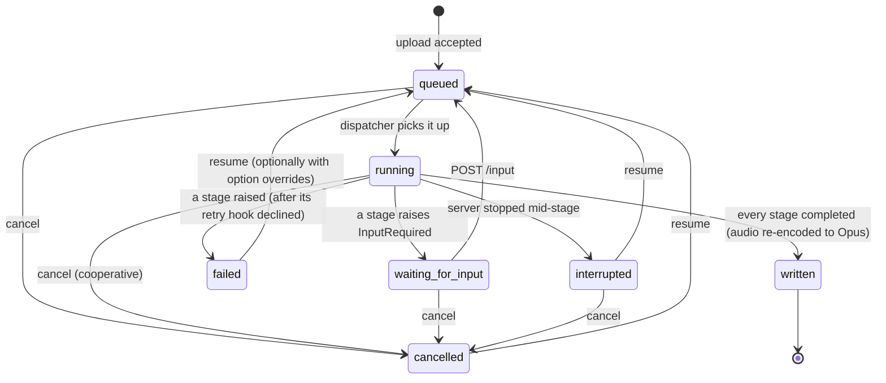

# Jobs, stages and checkpoints

Phase 04 built the job system that every processing step runs on. Code: `src/meetingmaster3/jobs/`,
`audio/`, `storage/` and `web/api/jobs.py`. Spec: §3 step 4, §15.2 R4, R5, R7 and R8, ADR-0013.

## Overview
```
POST /api/jobs ──▶ upload streamed to <data>/jobs/<id>/original.<ext> ──▶ ffprobe ──▶ job row (queued)
                                                                                    │
JobRunner dispatcher ◀── asyncio.Queue ◀────────────────────────────────────────────┘
   │  up to jobs.max_concurrent jobs in flight
   ▼
for each stage from the first incomplete one:
   GPU stage?  acquire the global GPU semaphore (held across consecutive GPU stages)
   run stage.run(ctx) in a worker thread ──▶ artifact file in the job folder
   record artifact + status in job_stages ──▶ ProgressBus ──▶ SSE /api/jobs/<id>/events
```

## Job states

The table is `jobs.models.TRANSITIONS`; `JobRepository.set_status` refuses anything else with
`E_JOB_STATE` (HTTP 409). A test walks every pair of states.

Stage states: `pending`, `running`, `waiting`, `completed`, `failed`, `cancelled`, `interrupted`.

### Startup and shutdown
- **Startup** (`JobRunner.recover`): jobs left `running` by a crash become `interrupted` with error
  code `E_INTERRUPTED`, and their running stage becomes `interrupted`. Jobs still `queued` are queued
  again. Interrupted jobs are **not** resumed automatically; the user resumes them (a job that crashed
  the server should not crash it again on every start).
- **Shutdown** (`JobRunner.stop`, called from the app lifespan): running stages are asked to stop
  (`ctx.check_cancelled()` raises), their jobs become `interrupted`, and the runner waits up to 10 s.

## The Stage protocol
```python
class Stage(Protocol):
    name: str  # stable id stored in job_stages.stage
    display_name: str  # shown in the UI ("Transcribing")
    uses_gpu: bool  # serialised by the global GPU semaphore

    def run(self, ctx: StageContext) -> Path: ...  # in a worker thread
    def should_retry(self, ctx: StageContext, exc: Exception) -> bool: ...  # retry hook
```
Subclass `jobs.stage.BaseStage` for the defaults (no retry, CPU, display name from `name`).

`StageContext` gives a stage:

| Member | Use |
|---|---|
| `job`, `job_id`, `job_dir`, `settings` | The job row, its folder and the app settings. |
| `options` | The job's options (`JobOptions` as a dict). Changes made in `should_retry` are saved. |
| `artifacts` | Paths of completed earlier stages' artifacts, keyed by stage name. |
| `attempt` | 1 on the first run of this stage in this run of the job. |
| `progress(fraction, message, eta_seconds=None)` | Live progress; the ETA is estimated from the rate when omitted. |
| `check_cancelled()` | Call between chunks of work; raises `JobCancelled`. |
| `sleep(seconds)` | Cancellable sleep. |
| `artifact(name)`, `write_json(name, data)` | A path in the job folder; atomic JSON write. |
| `input()` | The answer to this stage's `InputRequired`, once submitted. |
| `db` | The app `Database` (for repositories such as `RecentMeetingsRepository`). |
| `warn(message)` | A user-visible warning that does not fail the stage (Phase 06). It is published as progress, kept in the stage's `detail.warnings` on completion or failure, and listed in `GET /api/jobs/{id}` as `warnings: [{stage, message}]`. |

Rules:
- **The artifact must be a file inside the job folder** (`E_STAGE_ARTIFACT` otherwise). A stage that
  writes elsewhere (the vault) records what it wrote in a JSON artifact (Phase 09's `write` stage).
- **Write artifacts atomically** (`ctx.write_json`, `vault.io.atomic_write_text`, or write a temp file
  and `os.replace`), so a crash never leaves a half-written checkpoint.
- **Lazy-import ML libraries inside `run`**, never at module import.
- **Cancellation is cooperative.** Call `ctx.check_cancelled()` at least every few seconds of work
  (between chunks or batches where the library allows).
- **Retries:** after `run` raises, the runner calls `should_retry(ctx, exc)` with `ctx.attempt`. Return
  True to run again (for example after CUDA OOM: lower `ctx.options["batch_size"]`, retry once). Return
  False to fail the job with the exception's `MM3Error` code (or `E_STAGE_FAILED`). An `MM3Error`'s
  optional `details` dict is stored with the stage's error (`detail.error.details`), e.g. the
  transcription stages' `{"suggested_overrides": {"transcription_model": "medium"}}` after a second
  out-of-memory error.
- **Human input:** raise `InputRequired(kind, payload)`. The stage becomes `waiting`, the job
  `waiting_for_input`, and the GPU slot is released. `POST /api/jobs/{id}/input` validates the answer
  with the stage's optional `validate_input(data)`, saves it as `input.<stage>.json` and queues the job;
  the stage runs again and finds the answer with `ctx.input()`. `AwaitInputStage` packages this
  pattern; `speakers.stages.SpeakerConfirmationStage` is the `await_speaker_confirmation` stage
  (Phase 07).

## Adding a stage
1. Implement the stage (see above) in its own package, e.g. `transcription/stages.py`.
2. Wire it into `jobs.pipeline._default_factory` (with a lazy import, as all built-in stages do), or
   register it: `jobs.pipeline.register_stage(name, lambda settings: MyStage(settings))` replaces a
   stage's implementation (tests, plugins). A stage name with neither gets `UnavailableStage`, which
   fails with `E_STAGE_UNAVAILABLE` and an install hint. (`transcribe`, `align` and `diarize`:
   `transcription.stages.build_stage` returns the WhisperX stage when the `ml` extra is installed,
   otherwise an `UnavailableStage` saying "Transcription engine not installed".)
3. A stage whose GPU use depends on the job can define `gpu_for(options) -> bool`; the runner calls it
   instead of reading `uses_gpu` (see `templates.stages.GenerateStage`).
4. Use the canonical name from `jobs.pipeline.MEETING_STAGES`. Adding a **new** stage name to that list
   changes the stage list of new jobs only; older jobs whose stored stages differ fail resume with
   `E_PIPELINE_CHANGED`.
5. Test it with a `StageContext` built by hand (see `tests/unit/jobs/test_ingest.py`) and through the
   runner with a custom pipeline factory (`tests/unit/jobs/helpers.py`).

## Canonical pipeline and checkpoint artifacts
| # | Stage | GPU | Artifact (in `<data>/jobs/<id>/`) | Implemented in |
|---|---|---|---|---|
| 1 | `ingest` | no | `audio.wav` (16 kHz mono PCM) | Phase 04 |
| 2 | `transcribe` | yes | `transcript.json` | Phase 06 |
| 3 | `align` | yes | `aligned.json` | Phase 06 |
| 4 | `diarize` | yes | `transcript.final.json` (a serialised `domain.Transcript`; `diarization.json` alongside) | Phase 06 |
| 5 | `speaker_suggest` | yes | `speakers.json` (`speaker_embeddings.json` alongside while waiting, voiceprints on only) | Phase 07 |
| 6 | `await_speaker_confirmation` | no | `speakers.confirmed.json` (`speaker_map.json`, `transcript.named.json` alongside; the raw answer is `input.await_speaker_confirmation.json`) | Phase 04, replaced in 07 |
| 7 | `generate` | local Ollama only* | `notes.draft.md` (`generation.json`, and `generate.partial.json` while unfinished) | Phase 09 |
| 8 | `write` | no | `written.json` (`write.intent.json` alongside) | Phase 09 |

\* `GenerateStage.gpu_for(options)` is true when the job's backend is a local Ollama, which shares
the GPU with transcription (R5).

### The `import` pipeline (Phase 15k, R32)
`build_pipeline("import", …)` (job type `import`, created by `POST /api/imports` or `mm3 import`)
runs a text file instead of audio. Details: [`importing.md`](importing.md).

| # | Stage | GPU | Artifact | Notes |
|---|---|---|---|---|
| 1 | `import_parse` | no | `transcript.parsed.json` (`import.json` preview alongside; the upload is `source.<ext>`) | parses and converts; records `options.import_format` |
| 2 | `await_speaker_confirmation` | no | `speakers.confirmed.json` (`transcript.imported.json`, `speaker_map.json`, `transcript.named.json`) | `ImportConfirmationStage`, question kind `import_confirmation`; answer `{"speakers": {label: name}, "turns": {"<i>": label}}`; skipped with `options.import_confirmed` |
| 3 | `generate` | local Ollama only | as above | reads `transcript.imported.json`; adds `mm3-source*` |
| 4 | `write` | no | as above | the companion gets `mm3-source*` too |

There is no audio (`audio_path` is null): retention and pruning do nothing, `/audio` is 404 and
pinning is refused (`E_AUDIO_MISSING`). The registry overrides the import's own stages under
`import:import_parse` and `import:await_speaker_confirmation`; `generate` and `write` are shared.
An unknown job type is `E_JOB_TYPE` (400).

### Transcription stages (Phase 06)
Implemented in `transcription/stages.py` (user guide: [`../user-guide/transcription.md`](../user-guide/transcription.md);
ADR-0014). Each stage loads its own model through `transcription.engine.Engine` and frees it before
returning (`del`, `gc.collect()`, `torch.cuda.empty_cache()`), so after `diarize` nothing is left on
the GPU.

| Artifact | Content |
|---|---|
| `transcript.json` | `language`, `language_detected`, `language_probability`, `model`, `compute_type`, `batch_size`, `device`, `duration`, `segments` (`start`, `end`, `text`, `avg_logprob`) |
| `aligned.json` | the same, plus `aligned` (bool) and per-segment `words` (`word`, `start`, `end`, `score`; NaN becomes `null`) |
| `diarization.json` | `status` (`ok`, `disabled`, `skipped`, `failed`, `empty`, `no_speech`), `model`, `turns` (`start`, `end`, `speaker`), `speakers` (seconds per label), and `error` (`code`, `message`, `hint`) on a fallback. No voice embeddings. |
| `transcript.final.json` | `domain.Transcript`. Segments are split where the word-level speaker changes (WhisperX segments are VAD chunks of up to 30 s); `diarized=false` and no labels when diarization did not run. |

Behaviour:
- **Options** (job option > setting > hardware recommendation): `transcription_model`, `compute_type`,
  `batch_size`, `language`, `on_non_english`, `diarize`, `min_speakers`, `max_speakers`. The job
  option `model` is the LLM model, not the transcription model.
- **Language gate:** after loading the model, `transcribe` detects the language from the first 30 s.
  For non-English audio with `on_non_english: ask` it raises `InputRequired("language", {detected,
  language_name, probability, choices: ["proceed", "abort"], message})`. Answer with
  `POST /api/jobs/{id}/input` `{"action": "proceed"}` (optionally `"language": "en"`) or
  `{"action": "abort"}` (the job becomes `cancelled` and the answer is forgotten, so resuming asks again).
  Policy `abort` fails with `E_NOT_ENGLISH`; `proceed` continues with a warning.
- **Out of memory:** any stage catches CUDA OOM (torch `OutOfMemoryError`, CTranslate2 messages) and raises
  `MM3Error("E_OOM")`; `should_retry` frees memory and retries once (`transcribe`: half the batch size,
  `int8_float16`). A second OOM fails `transcribe` with `E_OOM` and `details.suggested_overrides`;
  for "Retry with a smaller model" call `POST /api/jobs/{id}/resume` with
  `{"overrides": {"transcription_model": "medium"}}`. A second OOM in `align` or `diarize` falls back
  (no word timings / no speakers) with a warning instead.
- **Fallbacks** never fail the job: alignment unavailable keeps segment timestamps; no token (and no
  cached model), refused access, an error or `diarize: false` gives a non-diarized transcript with a
  warning.
- **VRAM handoff:** on CUDA, `transcribe` first calls `transcription.handoff.release_local_llm`, which
  asks the job's LLM backend to unload (`OllamaBackend.unload_all()`) only if it is an Ollama on this
  machine (`transcription.unload_ollama`).
- **Cancellation:** WhisperX and pyannote progress callbacks call `ctx.check_cancelled()`, so a cancel
  stops at the next chunk.
- **Network:** cached models load without contacting Hugging Face; library telemetry is forced off.

Other files in a job folder: `original.<ext>` (the upload; the extension comes from an allowlist,
otherwise `.bin`), `audio.opus` (after `written`), `input.<stage>.json` (answers).

**Resume (R4):** the runner restarts at the first stage that is not `completed` **or whose artifact
file is missing**, and resets that stage and every later one to `pending`. Completed stages before it
are never run again.

### Speaker stages (Phase 07)
Implemented in `speakers/stages.py` (user guide: [`../user-guide/speakers.md`](../user-guide/speakers.md);
ADR-0015, spec R21). Both are built into `jobs.pipeline` (no registration needed).

**`speaker_suggest`** (`SpeakerSuggestStage`, `uses_gpu=True`) reads `transcript.final.json` and
`diarization.json`. A transcript without speakers gives `{"diarized": false, "speakers": []}`. Otherwise,
per label: talk time, overlap-free speech, the chosen embedding windows and up to 3 sample snippets
(`speakers.embeddings.profile_speakers`). Only with `privacy.voiceprints_enabled` it embeds the windows
(WeSpeaker ResNet34 from the cached diarization snapshot, `PyannoteEmbedder`; GPU if available), ranks
known people (`speakers.match.match_speakers`) and writes `speaker_embeddings.json`. An embedding failure
(engine or model missing, any error) is a warning: the job still waits for names, without suggestions.

`speakers.json`:
```json
{"diarized": true, "voiceprints_enabled": true, "model_id": "pyannote/…/embedding@6f10ff60898a1d18",
 "threshold": 0.6,
 "speakers": [{"label": "SPEAKER_00", "placeholder": "Speaker 1", "talk_seconds": 24.8,
               "clean_seconds": 19.1, "embedded_seconds": 13.4, "embedded_segments": 3,
               "low_confidence": false, "snippets": [{"start": 3.2, "end": 9.2}],
               "candidates": [{"person_id": "…", "name": "Alice", "score": 0.93, "suggested": true}],
               "suggestion": {"person_id": "…", "name": "Alice", "score": 0.93, "suggested": true}}]}
```
It is also the `waiting_for` payload (`kind: "speaker_confirmation"`). It never contains vectors.

**`await_speaker_confirmation`** (`SpeakerConfirmationStage`) completes at once for a transcript without
speakers. Otherwise it waits for `{"speakers": {label: name | {"name", "person_id"?, "enroll"?}}}`
(`POST /api/jobs/{id}/speakers` with the bare mapping, or `/input`), normalised by
`speakers.stages.normalise_answer` to `{label: {"name", "person_id", "enroll"}}`. Labels left out keep
their placeholder; labels not in the transcript are ignored with a warning. After the answer it:
1. enrolls the `enroll: true` speakers when voiceprints are enabled (labels with the same `person_id`,
   or the same name, are merged into one duration-weighted embedding; a name matching exactly one stored
   person reuses it; the stored name follows the confirmed one);
2. stores the job's one speaker map via `speakers.cascade.save_job_speakers` (`speaker_map.json` and
   `transcript.named.json`, the transcript with `speaker_name` on every segment);
3. deletes `speaker_embeddings.json`;
4. writes `speakers.confirmed.json`: `speakers` (normalised entries with the final `person_id`),
   `speaker_map` (label → name), `participants` (confirmed names in label order, merged names once) and
   `enrolled` (`person_id`, `name`, `labels`).

**Cascade (for Phases 09 and 11).** `speakers.cascade.apply_speaker_map(map, transcript, meta=,
companion=, old_map=)` returns the named transcript (generation context), `MeetingMeta` with `speakers`
(→ `mm3-speakers`) and `participants` updated (names from `old_map` replaced, hand-added participants
kept, placeholders never added), and the companion with the new map. `rename_companion_text(text, map)`
renames an existing companion file in place. `load_job_speaker_map(job_dir)` reads the stored map.

### Generation stages (Phase 09)
Implemented in `templates/stages.py` (ADR-0016 to ADR-0018, spec R22; template format in
[`template-format.md`](template-format.md); user guide [`../user-guide/templates.md`](../user-guide/templates.md)).

**`generate`** (`GenerateStage`): loads the template (`options.template` or
`generation.default_template`) from the library (built-ins + the vault's templates folder, installed
on first use), the backend (`options.backend` or `llm.default_backend`) and the model
(`options.model`, else the backend's `default_model`, else `E_LLM_CONFIG`). It builds `MeetingMeta`
from the job (title, `meeting_date` + `meeting_time`, else the upload day; `participants`, `tags`
prefixed with `meeting`, `location`) and fills speakers and participants with
`speakers.cascade.apply_speaker_map`. The generation context is `transcript.named.json`.
* **Cloud consent (S6):** a non-local backend without `cloud_consent` (or the backend's
  `consent_remembered`) raises `InputRequired("cloud_consent", {"backend", "backend_kind", "badge",
  "message"})`. Answer `{"consent": true}` (sets the job option `cloud_consent_for: <backend>`) or
  `{"consent": false}` (the job fails with `E_CONSENT_REQUIRED`; nothing was sent).
* Sections are generated one by one with progress `Writing <title>` (map-reduce adds `Reading part
  i of n`); each finished section is saved in `generate.partial.json`, so a resume continues at the
  first missing section (the file is keyed by template, backend, model, instructions and transcript).
* Warnings (a skipped chunk, a section that hit its length limit, an empty answer) are job warnings.
* Output: `notes.draft.md`, a complete note rendered with `markdown.note_writer` (no transcript link
  yet) and `generation.json` (`template`, `backend`, `model`, `mode` full/map-reduce, `chunks`,
  `calls`, `reused_sections`).

**`write`** (`WriteStage`): resolves the vault (`vault_not_configured` and friends fail the stage;
resume after fixing), picks the stem with `vault.naming.allocate_note_paths` in the output folder and
records it in `write.intent.json`, writes the companion transcript (`build_companion` with the
label transcript and the job's speaker map, linking back to the note) and then the note (with
`mm3-transcript`), both via `atomic_write_text` (never overwriting). A file that already carries the
note's `mm3-id` (an earlier attempt) is left alone. With `generation.write_companion: false` only the
note is written, with a warning. Then `recent_meetings` is updated and `written.json` returned:
```json
{"mm3_id": "…", "vault_root": "/vault", "note_path": "/vault/Meetings/2026/2026-10-11 - Product Sync.md",
 "note_relative": "Meetings/2026/2026-10-11 - Product Sync.md",
 "transcript_path": "/vault/…/2026-10-11 - Product Sync.transcript.md",
 "transcript_relative": "Meetings/2026/2026-10-11 - Product Sync.transcript.md",
 "title": "Product Sync", "template": "executive-summary"}
```
Audio retention is applied by the runner afterwards, as before.

**Re-generating.** `JobRunner.resume(job_id, overrides, from_stage="generate")` re-runs `generate`
and `write` even if they completed; `JobRunner.update_options(job_id, overrides)` changes the options
of a queued or waiting job. `POST /api/jobs/{id}/generate` combines them (below).

## GPU exclusivity (R5)
One `asyncio.Semaphore(1)` is shared by all jobs. A job acquires it before its first GPU stage and
keeps it across consecutive GPU stages (`transcribe → align → diarize → speaker_suggest`), so another
job can never load models in between and push an 8 GB card out of memory. It is released before the
next CPU stage, on pause, on failure and on cancel. CPU stages of other jobs run in parallel (up to
`jobs.max_concurrent` jobs in flight).

## Progress and SSE
`ProgressBus` is an in-process pub/sub. Every event goes through the event loop's FIFO queue, gets a
per-job sequence number (`seq`) and is fanned out to subscribers; the latest event per stage is kept
for replay.

`GET /api/jobs/{id}/events` sends:
1. `event: snapshot`: the full job (`GET /api/jobs/{id}` body), with `seq` = the last event included.
2. `event: stage`: `{job_id, stage, status, fraction, message, eta_seconds, kind: "stage", seq, data}`.
   `fraction` is 0 to 1 or `null` (indeterminate). `status` `pending` with message "Waiting for the
   GPU" means the job is queued behind another job's GPU work.
3. `event: job`: job status changes (`kind: "job"`); `data.error` carries `{code, message, hint}` on
   failure, `data.input` the question when waiting.
4. A `: heartbeat` comment every 15 s.

Events with `seq` ≤ the snapshot's `seq` are skipped, so a reconnecting client never sees duplicates.
The stream ends after a `written`, `failed` or `cancelled` job event (resuming a job needs a new
stream). ETA: `elapsed × (1 − f) / f`, shown once a stage has at least 2 % progress and 1 s elapsed.

## Audio ingest (R7)
- The upload is parsed as a stream (`python_multipart.MultipartParser`) and written straight to the job
  folder with mode `0600`, so audio never lands in `/tmp`. The size limit (`audio.max_upload_mb`,
  default 2048) is enforced while streaming and from `Content-Length` (HTTP 413, `E_UPLOAD_TOO_LARGE`).
- `ffprobe` must find an audio stream with a positive duration (`E_AUDIO_UNSUPPORTED`, HTTP 422),
  otherwise the job folder is removed and no job is created.
- The `ingest` stage converts to 16 kHz mono 16-bit WAV. ffmpeg and ffprobe run from an argument list
  (no shell), with `-nostdin`, `--` before the input path, a timeout (60 s for probing, duration +
  120 s for transcoding) and output written to a temporary `.part` file and renamed.
- Missing ffmpeg raises `E_FFMPEG_MISSING` with install commands.

## Retention (R8, ADR-0006, ADR-0013)
At `written`, the runner re-encodes the best audio file (WAV, else the upload) to mono Opus at
`audio.opus_bitrate_kbps` (24) and deletes the upload and the WAV. If the encode fails, the
uncompressed audio is kept and a warning is logged. `jobs.audio_expires_at` = `written_at` + the
retention period. The pruner (`jobs.retention.prune`) runs at startup, every
`jobs.prune_interval_hours` (24) and on `mm3 jobs prune [--dry-run]`:
- it applies the **current** `privacy.audio_retention` setting to every written job (so switching to
  `forever` keeps old audio), and updates the recorded expiry;
- unfinished jobs (failed, cancelled, interrupted, waiting) keep their audio until
  `audio_retention_days` after their last change, unless retention is `forever`;
- pinned jobs (`POST /api/jobs/{id}/pin`) and queued or running jobs are never pruned;
- only audio files are deleted; transcripts and other artifacts stay. The audio endpoint then
  answers `410 E_AUDIO_EXPIRED`.

`delete_after_write` prunes the job's audio as soon as it is written.

## API summary
| Method and path | Purpose |
|---|---|
| `POST /api/jobs` | multipart `file` + optional JSON `options` (`JobOptions`: `title`, `meeting_date`, `diarize`, `min_speakers`, `max_speakers`, `template`, `backend`, `model` (LLM), `cloud_consent`, `transcription_model`, `compute_type`, `batch_size`, `language`, `on_non_english`, plus any extra keys). Title and date are pre-filled from the filename. `"remember_template": true` (sent by the New meeting page, not stored with the job) saves a valid `template` as `generation.default_template` (R29). 201 + the job. |
| `POST /api/imports` | Start an `import` job (Phase 15k): the same multipart shape and options, a text file under `importing.max_mb`, parsed before the job is created (422 `E_IMPORT_UNREADABLE` / `E_IMPORT_EMPTY`, 413 `E_IMPORT_TOO_LARGE`, nothing kept). Title and date default to the file's own, then the file name. 201 + the job. |
| `GET /api/jobs?status=…&limit=&offset=` | List jobs, newest first. |
| `GET /api/jobs/{id}` | Job, stages (with live fraction, message, ETA, `detail.warnings`, `detail.error.details`), `waiting_for` and `warnings` (all stages' warnings). |
| `POST /api/jobs/{id}/cancel` | Cancel a queued, running, waiting or interrupted job. |
| `POST /api/jobs/{id}/resume` | Resume a failed, cancelled or interrupted job; body `{"overrides": {...}}` optional. |
| `POST /api/jobs/{id}/input` | Answer a waiting job, e.g. `{"speakers": {"SPEAKER_00": "Alice"}}` (an import: `{"speakers": {...}, "turns": {"3": "SPEAKER_01"}}`), for the language question `{"action": "proceed"}`, for cloud consent `{"consent": true}`. |
| `POST /api/jobs/{id}/generate` | `{"template"?, "backend"?, "model"?, "instructions"?, "cloud_consent"?}`. Queued or waiting job: stores the options (and answers a pending `cloud_consent` question when the new backend is local or consent is given). Failed, cancelled or interrupted job: resumes from `generate`. Running or written job: 409 `E_JOB_STATE`. Returns the job. |
| `GET /api/templates` | `{"default", "templates": [{id, name, description, tags, favorite, source (builtin/vault), overrides_builtin, file, valid, sections, issues}]}`, favourites first, invalid files last. |
| `POST /api/templates/install` | Copy the built-in templates into the vault (`results`: `installed`, `updated`, `unchanged` or `kept` per file). |
| `POST /api/notes/regenerate-section` | `{"note": "<vault-relative path>", "section_id", "instructions"?, "backend"?, "model"?, "cloud_consent"?}` → `{note, section_id, title, old_body, new_body, unified_diff, side_by_side, stats, template, backend, model}`. Writes nothing. 404 `E_NOTE_NOT_FOUND` / `E_SECTION_NOT_FOUND`, 409 `section_markers_invalid` (R11) / `E_TRANSCRIPT_MISSING`, 403 `E_CONSENT_REQUIRED`. |
| `GET /api/jobs/{id}/speakers` | `speakers.json` plus `job_id`, `status`, `waiting` and `confirmed` (`speakers.confirmed.json` or null); 409 `E_SPEAKERS_NOT_READY` before `speaker_suggest` completed. |
| `POST /api/jobs/{id}/speakers` | Confirm names: `{"SPEAKER_00": {"name": "Alice", "person_id": "…" \| null, "enroll": true}, "SPEAKER_01": "Bob"}` (or wrapped in `{"speakers": …}`). 422 for unknown labels, invalid entries or a deleted person; 409 `E_JOB_STATE` when not waiting. Resumes the job. |
| `GET /api/voiceprints` | `{"enabled", "people": [{person_id, name, created_at, last_seen, samples, total_seconds, models}]}`; never vectors. |
| `DELETE /api/voiceprints/{person_id}` | Forget one person (404 if unknown). |
| `DELETE /api/voiceprints?confirm=` | Forget everyone. Without a valid token: 428 `E_CONFIRM_REQUIRED` with `details.confirm_token` (single use, 5 minutes), nothing deleted. |
| `DELETE /api/jobs/{id}?force=` | Delete the job folder and rows (409 while active; pinned needs `force=true`). Vault notes are not touched. |
| `POST /api/jobs/{id}/pin`, `/unpin` | Keep the audio regardless of retention. |
| `GET /api/jobs/{id}/audio` | The best audio file, with HTTP Range (`audio/ogg` for Opus). |
| `GET /api/jobs/{id}/events` | SSE (above). |

All POST and DELETE routes need the CSRF header (S2). Errors use the standard
`{code, message, hint}` body.

## Fake pipeline
`MM3_FAKE_PIPELINE=1 uv run mm3 serve` replaces every ML and LLM stage with a fake from
`jobs/fakes.py` (the real ffmpeg `ingest` still runs). Each fake takes `MM3_FAKE_STAGE_SECONDS`
(default 2) and writes plausible artifacts, including a two-speaker transcript. `FakeGenerate` is the
real generation stage with the offline `llm.fake.FakeLLMBackend` (cloud-like when the chosen backend
is, so the consent question appears), and `FakeWrite` is the real write stage when a vault is
configured (otherwise it only records what it would write). `FakeSpeakerSuggest` is the real suggestion stage with a deterministic
`FakeEmbedder`, so with `MM3_PRIVACY__VOICEPRINTS_ENABLED=true` a second upload suggests the names you
enrolled from the first. Try it:
```bash
MM3_FAKE_PIPELINE=1 uv run mm3 serve &
curl -s -c /tmp/cj http://127.0.0.1:8765/ -o /dev/null
TOKEN=$(awk '/mm3_csrf/{print $7}' /tmp/cj)
ID=$(curl -s -b /tmp/cj -H "X-CSRF-Token: $TOKEN" -F "file=@meeting.m4a" \
     -F 'options={"title":"Demo"}' http://127.0.0.1:8765/api/jobs | jq -r .id)
curl -N http://127.0.0.1:8765/api/jobs/$ID/events      # streams until waiting_for_input
curl -s -b /tmp/cj -H "X-CSRF-Token: $TOKEN" -H 'Content-Type: application/json' \
     -d '{"speakers":{"SPEAKER_00":"Alice","SPEAKER_01":"Bob"}}' \
     http://127.0.0.1:8765/api/jobs/$ID/input        # the job finishes
```
