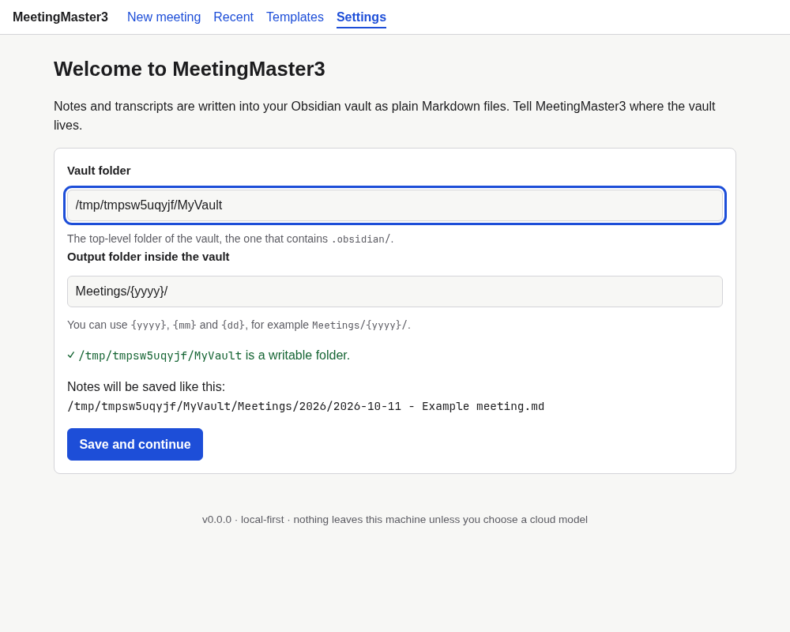
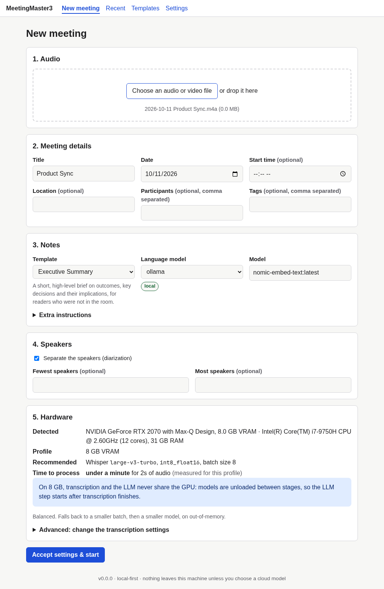
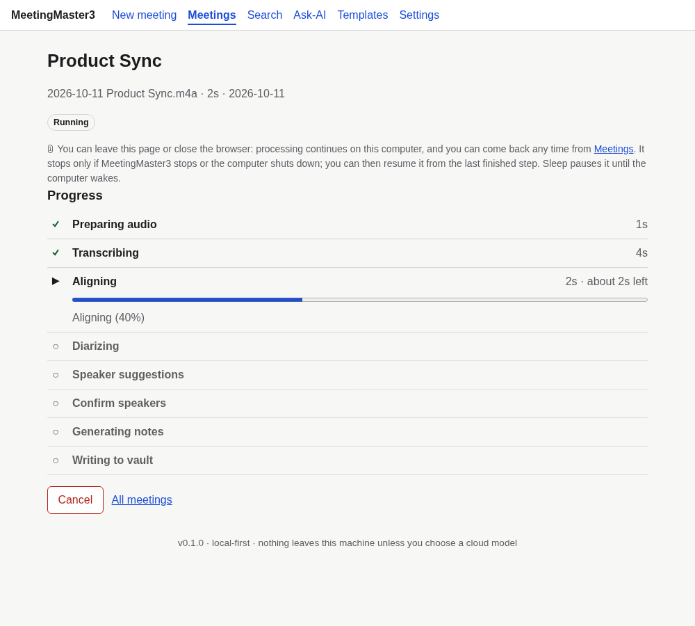
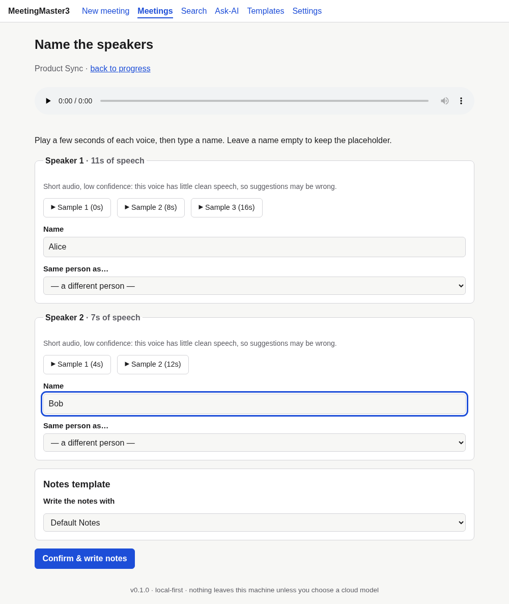
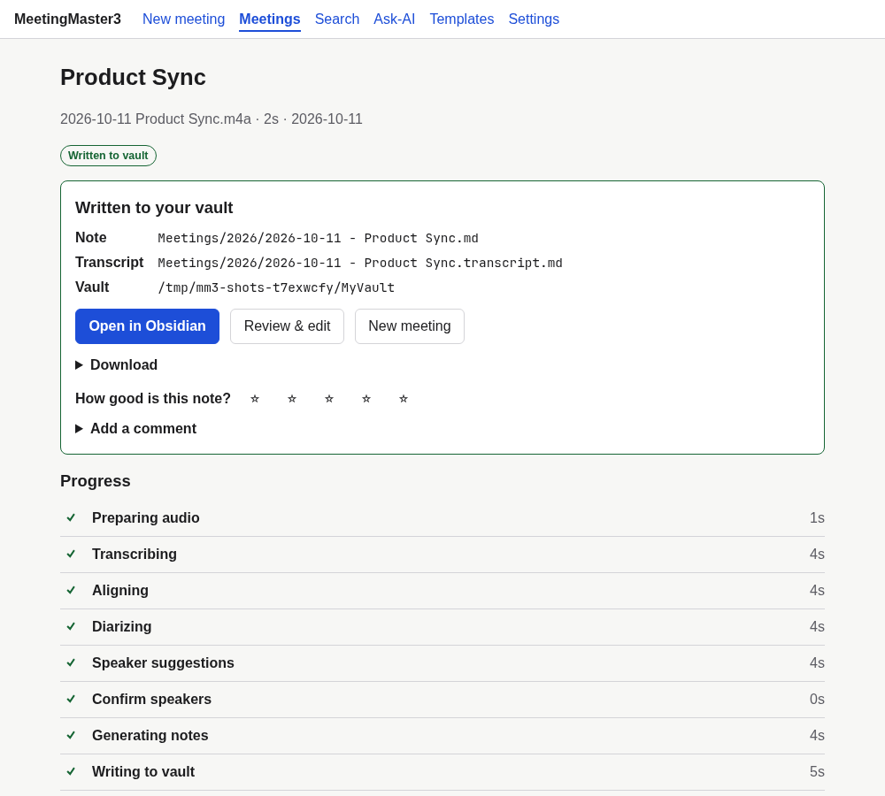

# Getting started: from a recording to a note in your vault

Start the app and open <http://127.0.0.1:8765>:

```bash
uv sync --extra ml          # the transcription engine (see install-native.md)
uv run mm3 serve
```
Want to click through without models? `MM3_FAKE_PIPELINE=1 uv run mm3 serve` simulates every stage and writes a
real (placeholder) note into your vault.

## 1. Choose your vault (first run)
Type the folder of your Obsidian vault, the one that contains `.obsidian/`. The page checks it as you type: the
folder must exist and be writable (otherwise you get the reason and what to fix), and a missing `.obsidian/`
only shows a warning. The output folder accepts `{yyyy}`, `{mm}` and `{dd}`; the line below shows exactly where
the next note would go. *Save and continue* stores the choice in `config.yaml` and copies the starter templates
into the vault.



## 2. New meeting
Pick or drop an audio or video file. The title, date and time are guessed from the file name and stay editable.
Dates such as `2026-09-22`, `09-22-2026`, `9-22-26`, `09-22`, `Sep 22` or `22 Sep` are recognised (month first,
as in the US). A date without a year takes the current year, or last year if that would put it in the future
(`12-30` picked on 2 January is last December). When the date came from the file name, *From the file name*
appears under the Date field until you change it. Your own edit always wins.
Then choose:
- **Template** (favourites first; invalid templates are listed but disabled, with the first problem).
- **Language model** and model. The badge says `local` or `cloud: <provider>`. Choosing a cloud backend opens a
  dialog explaining that the transcript text (not the audio) would be sent; *Use a local model* goes back.
  For a local backend the list only offers models that can write notes. Embedding models (such as
  `nomic-embed-text`, used for search) and models whose context window is too small are left out. When no
  default model is set, a tested model (`qwen3:8b`) is picked if it is installed. A model typed in by hand is
  checked too: the page says why it will not work and does not start. The server checks again when the meeting
  is submitted, so an unusable model never costs you a transcription.
- **Speakers**: separate speakers or not, and optionally the fewest and most speakers.
- **Hardware**: what was detected, the recommended Whisper model, and how long it should take for this file.
  *Advanced* lets you override the transcription model, compute type and batch size. Leave it alone to accept the
  recommendation, then press *Accept settings & start*.



## 3. Progress
The job page lists every stage with a bar, message, time spent and an ETA, and updates by itself. **You can leave
the page or close the browser: processing continues on this computer, and you come back any time from Meetings.** It
stops only if MeetingMaster3 stops or the computer shuts down, and can then be resumed from the last finished
step (a quiet line under the title says so, and the browser tab shows the progress, for example
`42% · Transcribing`, then `✓ Notes ready`). *Cancel* stops the job (finished stages are kept and
*Resume* continues). If something fails you see what happened and what to do:
- **Retry**, or **Retry with smaller model** after a GPU out-of-memory error.
- If **writing the notes** fails (the model is unsuitable, its context window is too small, it timed out, and so
  on), a **Try another model** box lists every model you can use: installed local models, with their context
  size, and each cloud backend's default model. Models that cannot write notes are shown greyed out with the
  reason, and a recommended model is pre-selected. *Write the notes with this model* keeps the transcript and
  speaker names and only writes the notes again. *Use this model for new meetings too* (on by default) saves it
  as that backend's default model. A cloud model still asks for consent first.
- "Transcription engine not installed" shows the install command.
- Warnings, such as speakers not separated because no Hugging Face token is set, appear in a yellow box.
- For a recording that does not sound like English you are asked whether to continue, treat it as English, or stop.



## 4. Name the speakers
When the transcript is ready the job asks for names. Each speaker has a card with their talk time, up to three
audio samples to play, suggestions from remembered voices, a name field (with your known people offered as you
type), *Same person as…* to merge two voices, and, if voice recognition is enabled in the configuration, a
*Remember this voice* box (see [`speakers.md`](speakers.md) for what that stores). Leave a name empty to keep the
placeholder. You can still change the template here. *Confirm & write notes* resumes the job.



If the chosen backend is a cloud one and you did not agree in the dialog, the job pauses once more and asks
before anything is sent: *Allow*, *Use a local model instead* or *Don't send*.

## 5. Done
The completion box shows the note and transcript paths, an **Open in Obsidian** link and **Review & edit**, which
opens the review workspace: the recording and transcript side by side with the note, which you can edit,
regenerate section by section and save back to the vault. See [reviewing and editing](reviewing-and-editing.md).

Three files are written next to each other:
- `2026-09-22 - Title.md`, **the note**. Every built-in template starts with **Summary Succinct** (a few
  sentences) and **Summary Detailed** (typically three paragraphs: purpose, the discussion and who said what,
  outcomes and open questions). The header line *Transcript: Read the transcript* opens the readable transcript.
- `2026-09-22 - Title (Transcript).md`, **the readable transcript**: laid out like the review screen, with the
  time, then each speaker's name highlighted in their own colour, then what they said. It is made for reading in
  Obsidian; edits to it are replaced the next time the transcript changes (for example after renaming a
  speaker). Turn it off with `generation.readable_transcript` (Settings, Notes).
- `2026-09-22 - Title.transcript.md`, **the companion transcript**: the full-fidelity copy with word timings that
  the app uses to re-open, regenerate and rename. Do not edit it by hand.



## Other pages
- **Meetings** (the top menu's second item) is the one place to find a meeting. **Jobs** lists every job (resume
  interrupted ones, delete old ones), **Notes in your vault** lists the notes you wrote, and **Browse the vault** at
  the bottom opens any note MeetingMaster3 wrote. Each section shows 10 rows at a time (25 in Browse the vault),
  with *‹ Newer · Page 2 of 5 · Older ›* controls; the page address remembers where you were. A note that
  was deleted or moved, or that lies outside the vault you now use, is marked *File not found* or *Not in your
  vault*; **Remove from list** forgets one entry and the box above the list removes all such entries at once.
  Only the list entry goes: the app never deletes a note file from here, and an entry comes back when you open
  that note again.
- **Update older notes** (on Meetings, when there is something to do): notes written before the current format
  can gain **Summary Detailed** (written by your default model from each note's companion transcript), have a
  "Summary" heading renamed to "Summary Succinct" (a heading you changed is kept) and get a readable transcript.
  The card lists what would change, the model and an estimate; *Preview* writes one note's new section without
  saving it; *Update* runs in the background with progress, can be cancelled, and links each updated note. The
  previous version of every note goes to its `Archive` folder first, and a note you edit while it runs is
  skipped, never overwritten. Headless: `mm3 notes upgrade --dry-run`, then `mm3 notes upgrade`.
- **Templates** shows the library and its editor; **Settings** covers the vault, models, backends, privacy and
  feedback.

## Troubleshooting
- *"The vault folder does not exist"*: mount the drive or fix the path on the setup page (`/setup`).
- *Upload rejected*: the limit is `audio.max_upload_mb` (default 2048).
- *The page does not update*: reload; if the server stopped, restart `mm3 serve` and resume the interrupted job
  from **Meetings**.
