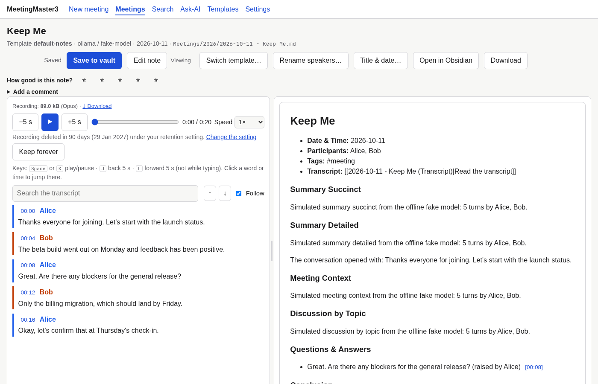
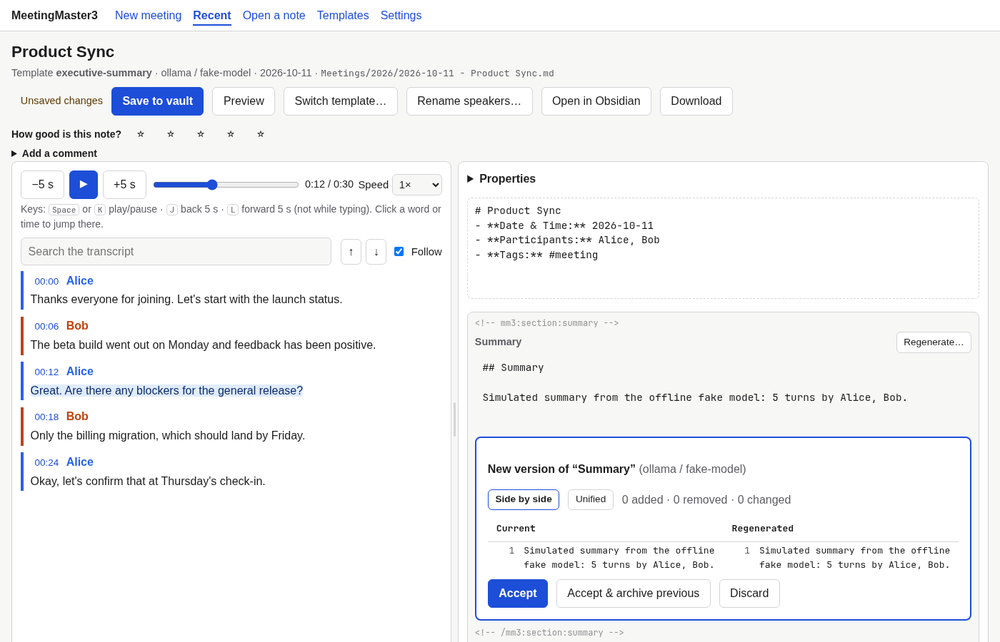

# Reviewing and editing a note

The review workspace is where a draft becomes your final note. It shows the recording and its
transcript on the left and the note on the right. Open it with **Review & edit** when a meeting
finishes, or from **Meetings**.

## Opening a note

- **After processing:** the job page's **Review & edit** button.
- **Meetings** (top menu): **Notes in your vault** lists the notes you wrote or opened, and **Browse the vault**
  at the bottom of the page is a browser of your vault. The browser lists only
  notes MeetingMaster3 wrote (files with an `mm3-id` property). Companion transcripts and archived
  versions are hidden, as are hidden folders such as `.obsidian`. You cannot browse outside the vault.
- A note that was not written by MeetingMaster3 opens as a read-only preview.

The address of the workspace is `/meetings/<mm3-id>`, so a bookmark keeps working after you rename or
move the note, as long as you have opened it once from its new place (or from **Browse the vault** on the Meetings page). The old **Open a note** address (`/open`) now lands on Meetings.

## The recording and the transcript

| Action | How |
|---|---|
| Play / pause | ▶ button, or <kbd>Space</kbd> or <kbd>K</kbd> |
| Back / forward 5 seconds | −5 s / +5 s, or <kbd>J</kbd> / <kbd>L</kbd> |
| Speed | 0.75× to 2× |
| Jump to a moment | Click a timestamp or any word in the transcript |
| Jump from the note | In **Preview**, click a `[mm:ss]` reference; in the editor, <kbd>Ctrl</kbd>/<kbd>⌘</kbd>-click it |
| Find text | The search box; <kbd>Enter</kbd> / <kbd>Shift</kbd>+<kbd>Enter</kbd> for next / previous |

The keyboard shortcuts do nothing while you are typing in a field. The sentence being played is
highlighted and kept in view. Scrolling the transcript yourself turns **Follow** off; tick it to
follow the playback again. Drag the bar between the panes (or focus it and use the arrow keys) to
change their widths; on a narrow screen the panes stack.

### How big the recording is, and downloading it

Above the retention line, a small muted line states the size and format of the stored recording
("Recording: 41.2 MB (Opus)"), so you can weigh it when you decide between **Keep forever** and the
default retention period. Next to it, **Download** saves the recording under the note's own name
(`2026-10-11 - Product Sync.opus`); the same file is in the header **Download** menu as "The recording".
Neither appears when there is no recording (it expired, was removed, or the meeting had none).

### How long the recording is kept

Under the player, one quiet line says what will happen to the recording, for example "Recording deleted
in 23 days (13 Jan 2027) under your retention setting". The days are the ones the retention check will
use (rounded up, so "1 day" can mean a few hours), and they change if you change the retention setting in
**Settings → Privacy**.

- **Keep forever** keeps this meeting's recording whatever the setting says (it is never deleted, and
  deleting the meeting asks you to confirm). The line then reads "Recording kept forever."
- **Allow deletion** undoes that, after asking. It tells you when the recording will then be deleted,
  or that it is due at the next check (the check runs daily and at start-up).
- If your setting is "keep forever" the line says so. **Keep this one even if the setting changes**
  still protects the meeting from a later change.

If the recording was already removed by the retention policy (see [configuration](configuration.md),
`privacy.*`), the player is replaced by a notice. The transcript still works.

## Editing the note

The note is shown in parts:

- **Properties:** the note's Obsidian properties (YAML), folded by default. Keep `mm3-id`: it links the
  note to its transcript and recording, and saving refuses a change to it.
- **Your own text** (dashed boxes): the title and header, and anything you write between or after
  the sections. MeetingMaster3 never rewrites this text.
- **Sections** (framed): the parts MeetingMaster3 generated, each between two marker lines such as
  `<!-- mm3:section:summary -->`. The markers are shown dimmed and cannot be edited here: they are
  how MeetingMaster3 finds a section again. Everything between them (the `## Heading` and the text)
  is yours to edit.

**Save to vault** (or <kbd>Ctrl</kbd>/<kbd>⌘</kbd>+<kbd>S</kbd>) writes the note atomically. Only the parts
you changed differ from the file on disk; every other byte stays as it was, including Windows line
endings.

Your unsaved edits are kept as a draft in MeetingMaster3's data folder while you type. If you close
the tab without saving, the next time you open the note it offers **Restore my edits** or **Discard
them**.

The note opens in **Preview**: the rendered note (raw HTML is not rendered; images are not loaded).
One button above the note always names what it will do: **Edit note** while you are viewing, **Show preview**
while you are editing (to see your edits rendered, saved or not). A small label beside it says whether you
are *Viewing* or *Editing*.
The page picks the right mode for you: restoring a draft or accepting a regenerated section opens Edit.
Saving keeps the mode you are in. The browser remembers the last mode you used. A read-only note shows
the preview only.

### When the note changed elsewhere

If the file was changed after you opened it (in Obsidian, by a sync tool, or in another tab), saving
does not overwrite it. You see both versions side by side and choose:

- **Keep mine:** overwrite the vault file with your version.
- **Take theirs:** discard your edits and reload the note from the vault.
- **Keep editing:** copy what you need from the comparison into your version, then save and keep mine.

## Regenerating a section

Each section has **Regenerate…**. Add instructions if you like ("Make it shorter", "Focus on the
budget") and, under **Model**, pick another backend or model. A cloud backend asks for your consent
for this request. While it works you see a progress bar, the time elapsed and a time-left estimate (see
[Progress while a template switch runs](#progress-while-the-model-works)); **Cancel** stops it. The new version is compared with the section as it is in the editor now (your
unsaved edits included). Switch between **Side by side** and **Unified** views, then:

- **Accept:** replace the section in the editor.
- **Accept & archive previous:** first save the current version of the section to the archive (below),
  then replace it.
- **Discard:** keep the section as it is.

Accepting changes only the editor; **Save to vault** to keep the result.

### Archives

Archived versions go to an `Archive` folder next to the note:

- One section: `Archive/2026-10-11 - Title.<section-id>.20261011-1530.md`
- A whole note (template switch): `Archive/2026-10-11 - Title.20261011-1530.md`

Archives carry an `mm3-archived` property, so they are not offered by **Browse the vault**.

## Rating and downloading

Rate the whole note with 1-5 stars (under the title) and each section with 👍 or 👎 (under the section),
optionally with a comment. Ratings stay on this computer; see [settings](settings.md) to export them.
**Download** in the header gives you the note as saved, the transcript (Markdown or plain text) or both
in one zip.

## Switching the template

**Switch template…** writes the whole note again with another template (this takes as long as
writing the notes did the first time). You see the new note compared with the current one before
anything is written. Applying it archives the current note whole, then writes the new one. Anything
you wrote outside the sections is kept at the end of the new note under **Preserved notes**, and your
own properties (for example `aliases`) are kept. Save your edits first: switching works on the note as
saved in the vault.

### Progress while the model works

A template switch (and a section regeneration) shows a bar with the step it is on ("Section 3 of 9:
Summary Detailed"), the **elapsed** time and **about N minutes left**. The bar's stripes keep moving even
when a long section is being written, and the clock keeps ticking, so you can tell that nothing has locked
up (with *reduce motion* set in your system, the stripes stop but the clock still ticks).

- The first time left is an estimate from your hardware profile (shown as "Roughly …"); once some sections
  are done it becomes a rate measured on this very run, smoothed so it does not jump about. With a cloud model
  there is no estimate until it can be measured. Past the estimate it says "Taking longer than expected, still
  working" instead of counting down to zero.
- You can keep reading the note while it runs. **Hide and keep running** (or pressing <kbd>Esc</kbd>, which
  asks) closes the window; a button next to **Switch template…** brings it back, and the preview waits there
  when it is ready. Reloading the page picks a running switch up again, but restarting MeetingMaster3 ends it.
- **Cancel the switch** stops the model call at once. Nothing is written or archived until you apply a preview.
- Only one long action runs per note at a time.

## Renaming speakers

**Rename speakers…** lists the speakers of the transcript. Change a name, or empty it to go back to
"Speaker N", and preview the changes. Applying them updates:

- the companion transcript (the names on each turn and its `mm3-speakers` property);
- the note's `mm3-speakers` and `participants` (people you added to `participants` by hand are kept);
- the **Participants** line under the title, unless you edited that line;
- names inside the generated sections (whole words only).

Your own text outside the sections is not changed. Renaming does not teach voice recognition the new
name: the voice samples of a meeting are deleted when its speakers are first confirmed (see
[speakers](speakers.md)).

## Changing the title or date

If a meeting was imported with the wrong title or date, **Title & date…** (next to *Open in Obsidian*) fixes it
everywhere. Type the new title, date and (optionally) time and choose **Preview the changes**. Nothing is
written yet. The preview lists:

- every file that is renamed: the note, its companion transcript, the readable transcript, archived versions
  and the copy of the recording in the vault, if there is one. All of them take the new
  `YYYY-MM-DD - Title` name. If the note is still in the folder for its old date (for example
  `Meetings/2026/`) and the new date belongs in another one, the files move there. If you moved the note
  somewhere yourself, it stays where it is;
- what changes inside them: the `title` and `date` properties, the heading, the *Date & Time* line and the
  links between the meeting's files;
- **"N links in M other notes will be updated"**: every other note in your vault that links to the meeting.
  MeetingMaster3 rewrites those links the way Obsidian would (keeping the alias, the `#heading` and `^block`
  parts). It copies each of these notes to a backup folder before changing it;
- warnings, for example sections that still mention the old title or date. Section text is never rewritten,
  so edit or regenerate those sections yourself if you want them to match.

**Rename the meeting** applies it, and the page reopens at the new name. Nothing else changes: the meeting id,
the sections, the transcript, the speakers, your own text and every other property stay exactly as they were.
The recording, its *Keep forever* setting and your ratings stay with the meeting.

- It is refused when a file with one of the new names already exists. Choose another title.
- You must save or discard your edits first, and wait for a running template switch or regeneration to finish.
- If the note or a linking note changes after the preview (in Obsidian, or by sync), applying stops and asks
  you to preview again.
- **Backups:** the record of the rename (`manifest.json`, with every old and new name, every changed link and
  the database rows before and after) and copies of every changed file are kept in MeetingMaster3's data
  folder, under `rename-backups/<date-time>-<meeting id>/` (on Linux `~/.local/share/meetingmaster3/`). They
  are not in your vault. Undoing a rename means renaming the meeting back. To undo it by hand, copy the files
  from `files/` back into the vault.
- If MeetingMaster3 stops in the middle of a rename (a crash or a power cut), the next start finishes the
  rename or undoes it. The Meetings page says which.
- Without a companion transcript, only the note and its archives are renamed. A note shown read-only can
  still be renamed.
- Headless: `mm3 meetings rename <meeting id or note path> --title "…" --date YYYY-MM-DD [--time HH:MM]`.
  Add `--dry-run` to see the plan only, and `--yes` to skip the question. `--time none` clears the time, and
  leaving `--time` out keeps it.

## When something is missing or damaged

| Situation | What you see | What you can do |
|---|---|---|
| The companion transcript is missing | The note opens with "Transcript not found"; regeneration, template switching and renaming are off | **Locate the transcript**: it is searched for in the whole vault. If it is next to the note under another name, **Link this transcript**; if it is elsewhere, move it next to the note. If the recording is still kept, **Transcribe the recording again** (this writes a new note). |
| A section's markers are damaged (for example a closing marker was deleted in Obsidian) | A warning naming the problem; the damaged text is shown as your own text and is never guessed at | **Append a fresh “…” section** writes a new copy of that section (as `<id>-2`) before AI Recommendations; delete the damaged text yourself when you are happy |
| The note has no MeetingMaster3 markers at all | A read-only view | Edit it in Obsidian |
| The recording was deleted by retention | A notice instead of the player | Everything else works |

If an edit in your own text adds, removes or changes a marker line (for example while repairing a damaged
section), saving asks you to confirm. A marker typed inside a section is refused.

See also: [getting started](getting-started.md), [templates](templates.md), [speakers](speakers.md).
